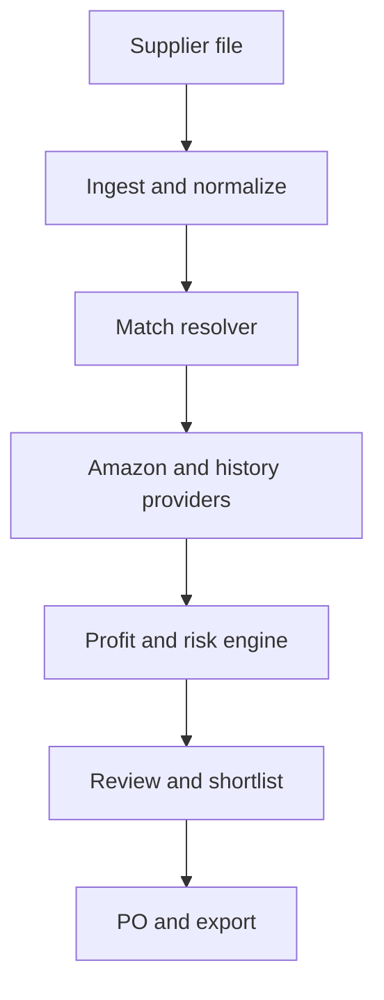

# RizPoint Sourcing OS

## Product blueprint and Codex build package

Prepared for RizPoint LLC — July 12, 2026

## 1. The decision

Build a web application inspired by Astro Advanced Analytics' workflow, but do not clone its branding, source code, proprietary scoring, or exact interface. The product should initially be a private operating system for RizPoint's own Amazon wholesale sourcing. After it proves accurate on real supplier sheets, turn it into a multi-tenant subscription product.

The first goal is not “more columns than Astro.” The goal is a system that makes fewer expensive buying mistakes and can explain every recommendation.

Working name: **RizPoint Sourcing OS**.

Core promise:

> Upload any supplier catalog and receive a purchase-ready shortlist whose matches, costs, risks, and assumptions can all be audited.

## 2. What Astro appears to do

From Astro's public site, FAQ, tutorial listing, and the supplied screenshots, its main workflow is:

1. Connect a North American or European Amazon seller account.
2. Upload a supplier spreadsheet.
3. Choose ASIN, UPC/EAN, or AI title matching.
4. Preview the sheet and map identifiers, cost, item number, description, and quantity.
5. Scan the catalog and enrich matched products with Amazon data.
6. Analyze and score the results.
7. Filter products into shortlists.
8. Generate purchase orders.

Publicly advertised capabilities include bulk scanning, ASIN scoring, historical data, profitability analysis, eligibility checks, shortlists, and purchase orders. Astro's FAQ says its title-matching feature can identify likely Amazon listings when a file lacks UPCs or ASINs.

This is a useful workflow reference. It is not enough by itself to build an accurate analyzer. The hard parts are reliable product matching, lawful/reliable data access, rate-limited background processing, pack and case interpretation, fee calculation, historical price context, and honest uncertainty.

References:

- [Astro Advanced Analytics](https://www.astroadvancedanalytics.com/)
- [Astro FAQ](https://www.astroadvancedanalytics.com/faq)
- [Astro price-list tutorial](https://www.youtube.com/watch?v=oTBrVL7WzyU)

## 3. RizPoint's strategic advantage

Generic scanners answer: “Does this row look profitable?”

RizPoint Sourcing OS should answer:

- Is this definitely the same product and pack count?
- Is the supplier price per unit, inner pack, display, or case?
- Which selling price is safe to model: current price, 30-day average, or conservative percentile?
- Is Amazon currently competing, and how often has it competed historically?
- Can this specific seller account list the ASIN?
- Is the brand prohibited by the supplier, allowed, or allowed only with written approval?
- Does MAP apply, and is the MAP value a unit price or case/display amount?
- What is the full landed cost for each shipping route?
- How does expiration risk affect the safe order quantity?
- Which assumption could reverse the decision?
- What evidence should be checked before placing the order?

### The five differentiators

1. **Truth Layer** — every metric carries its source, timestamp, confidence, and freshness.
2. **PackGuard** — detects case/unit/multipack mismatches before profitability is calculated.
3. **Route Optimizer** — compares VSI → OR/CA prep, VSI → Montana, and direct-to-Amazon scenarios.
4. **Approval Intelligence** — combines seller eligibility with RizPoint's supplier restriction and written-approval records.
5. **Decision Replay** — shows why a product passed today and what changed since the previous scan.

## 4. Non-negotiable business rules

The first production ruleset must reflect the current operation:

- Marketplace: Amazon.com / United States.
- Supplier: VSI, account-specific catalog and restrictions.
- VSI freight advantage: model free/paid freight to OR/CA according to the configured order threshold; never assume it for Montana.
- Montana Prep Solutions preset: default prep fee **$1.49 per unit for 1–200 monthly units**, editable by date and volume tier.
- First-order quantities normally range from 20–100 units.
- Pet products may be expiration dated. Require shelf-life and sell-through checks when relevant.
- Restricted-vendor states: `PROHIBITED`, `APPROVAL_REQUIRED`, `APPROVED`, `UNRESTRICTED`, and `UNKNOWN`.
- `MapPricing` and suggested retail values cannot be treated blindly as Amazon selling prices.
- A case/display price must never be compared with a single-unit Amazon listing.
- Amazon eligibility is seller-account-specific and must not be inferred from a generic brand list.
- The user must be able to override every cost assumption, but overrides must be logged.

## 5. Product scope

### Private MVP — prove the engine

Build this first:

- Email/password authentication for one organization.
- Supplier management and a VSI preset.
- XLSX, XLS, and CSV upload.
- Sheet selection, header detection, preview, and column mapping.
- Preserve UPC/EAN leading zeros.
- Normalize currency, weight, dimensions, quantity, case count, and pack count.
- Exact ASIN input and exact UPC/EAN catalog matching.
- Title matching fallback with confidence and human review.
- Amazon catalog, current pricing, fee estimate, sales rank, and seller-specific restriction enrichment where the connected account permits it.
- Optional historical data adapter behind a feature flag.
- Deterministic landed-cost and profit engine.
- PackGuard mismatch warnings.
- RizPoint/VSI restricted-brand overlay.
- Virtualized analysis table with saved filters.
- Shortlists, notes, status, and XLSX/CSV export.
- Purchase-order draft export.
- Scan history, audit trail, and data freshness.

### Commercial V1 — after the private MVP is accurate

- Multi-tenant organizations and role-based access.
- Secure Amazon OAuth connection per organization.
- Usage quotas and billing.
- Shared supplier templates and saved mapping profiles.
- Team comments, assignments, and approval workflow.
- Notification center and scan-completion email.
- Re-scan scheduling and change alerts.
- Product-level evidence panel and full decision replay.
- Subscription billing with one paid plan initially.

### Later “next-level” modules

- Brand outreach CRM and approval-document vault.
- Supplier quote comparison across multiple distributors.
- Expiration-aware reorder planning.
- Expected monthly profit constrained by offer share and safe velocity.
- Cash allocation optimizer: select the best portfolio of SKUs within a budget.
- Scenario Monte Carlo: price decline, fee increase, returns, and slow-sales stress tests.
- Browser extension for saving individual ASINs into the research board.
- Prep-center shipment notification and reconciliation workflows.
- Competitor/storefront discovery only where permitted by the selected data source and applicable terms.

## 6. Data-source strategy

### Amazon Selling Partner API

Use Amazon's official Selling Partner API (SP-API) for connected seller-account data.

- Catalog Items API: search Amazon catalog items by identifiers such as UPC/EAN and retrieve summaries, images, identifiers, sales ranks, dimensions, and relationships when available.
- Product Fees API: request Amazon's fee estimate for an ASIN or SKU. Amazon states that estimates are not guaranteed, so store the response timestamp and retain a contingency.
- Listings Restrictions API: check whether the connected seller can list an ASIN and whether approval is required.
- Product Pricing API: retrieve permitted competitive pricing and offer information.

Official references:

- [Catalog Items API](https://developer-docs.amazon.com/sp-api/docs/catalog-items-api)
- [Product Fees API](https://developer-docs.amazon.com/sp-api/lang-en_EN/docs/product-fees-api)
- [Listings Restrictions API](https://developer-docs.amazon.com/sp-api/docs/listings-restrictions-api)
- [Product Pricing API](https://developer-docs.amazon.com/sp-api/docs/product-pricing-api)

Important: implement each provider behind an interface. Rate limits and available fields can change, and access depends on the application and seller authorization.

### Historical price and demand context

SP-API alone should not be presented as a complete historical analytics feed. Create a `MarketHistoryProvider` interface. The first implementation can be:

- `MockHistoryProvider` for development and automated tests.
- A licensed provider adapter after the user obtains credentials and confirms its terms and pricing.

Never scrape Amazon pages as the core production data strategy. Do not build the business on brittle HTML extraction or data acquired contrary to platform terms.

### AI use inside the product

AI is appropriate for:

- Header and column suggestions.
- Parsing titles into brand, model, size, flavor, count, and unit.
- Ranking ambiguous title-match candidates.
- Explaining risk flags in plain language.
- Generating a human-readable decision summary.

AI must not directly calculate profit, fees, ROI, or landed cost. Those must be deterministic, versioned functions covered by tests. The matcher may propose a candidate; PackGuard and validation rules decide whether it is safe to accept automatically.

## 7. Recommended architecture

Use a monorepo with a TypeScript web application and a Python data worker.

### Stack

- Frontend/BFF: Next.js, TypeScript, React, Tailwind CSS, shadcn/ui.
- Data grid: AG Grid Community or TanStack Table plus virtualization. Start with an open-source option and isolate grid-specific code.
- API/data layer: Next.js route handlers for user-facing CRUD and FastAPI for scan-processing services.
- Spreadsheet/data processing: Python, Polars, openpyxl, and Pydantic.
- Database: PostgreSQL with Prisma for the web app; migrations are the source of truth.
- Jobs: Redis and a durable queue. Use BullMQ for orchestration or Celery for Python-first jobs; choose one and document the decision before implementation.
- Object storage: S3-compatible private bucket for uploads and exports.
- Authentication: Auth.js for private MVP; use an organization-aware provider before commercial launch.
- Observability: structured logs, Sentry, job metrics, and provider-call metrics.
- Local development: Docker Compose for PostgreSQL, Redis, and S3-compatible storage.
- Deployment: containerized web and worker services, managed PostgreSQL, managed Redis, and private object storage.

### System flow



### Job state machine

`UPLOADED → MAPPING_REQUIRED → READY → NORMALIZING → MATCHING → ENRICHING → CALCULATING → COMPLETED`

Terminal/error states:

`CANCELLED`, `FAILED_RETRYABLE`, `FAILED_FINAL`, `PARTIAL_SUCCESS`.

Every stage must be idempotent. A retry may continue from the last completed checkpoint without duplicating rows or charges.

## 8. Repository structure

```text
rizpoint-sourcing-os/
├── AGENTS.md
├── README.md
├── docs/
│   ├── PRODUCT.md
│   ├── ARCHITECTURE.md
│   ├── DATA_DICTIONARY.md
│   ├── PROFIT_ENGINE.md
│   ├── MATCHING.md
│   ├── SECURITY.md
│   └── ADR/
├── apps/
│   └── web/
├── services/
│   └── scanner/
├── packages/
│   ├── database/
│   ├── domain/
│   ├── provider-contracts/
│   ├── profit-engine/
│   ├── ui/
│   └── test-fixtures/
├── infra/
│   ├── docker/
│   └── deployment/
├── scripts/
└── tests/
    ├── contract/
    ├── e2e/
    ├── integration/
    └── golden/
```

## 9. Core domain model

Create explicit entities rather than one giant results table:

- `Organization`, `User`, `Membership`
- `AmazonConnection`, `ProviderCredential`
- `Supplier`, `SupplierWarehouse`, `SupplierRule`
- `PrepCenter`, `PrepRateCard`, `ShippingRoute`
- `BrandPolicy`, `ApprovalEvidence`
- `Upload`, `SheetProfile`, `ColumnMapping`
- `Scan`, `ScanStage`, `ScanEvent`
- `SupplierRow`, `NormalizedOffer`
- `CatalogProduct`, `ProductIdentifier`, `ListingCandidate`
- `MatchDecision`, `MatchEvidence`
- `MarketSnapshot`, `FeeSnapshot`, `RestrictionSnapshot`
- `CostScenario`, `ProfitResult`, `RiskSignal`, `DecisionResult`
- `Shortlist`, `ShortlistItem`, `Note`
- `PurchaseOrder`, `PurchaseOrderLine`
- `AuditEvent`

Use decimal database types for money and ratios. Never use binary floating-point for financial calculations.

## 10. Matching engine

Matching is a cascade, not a single AI call.

### Stage A — normalize

- Strip Excel numeric formatting without losing leading zeros.
- Validate UPC-A/EAN check digits when possible.
- Normalize brands and punctuation.
- Extract count, pack, size, unit, flavor, model, and variation tokens.
- Detect supplier phrases such as `6/cs`, `4/cs`, `display`, `inner`, and `pack of`.

### Stage B — deterministic candidates

Priority:

1. Supplied ASIN.
2. Exact UPC/EAN/GTIN catalog identifier.
3. Manufacturer part number plus brand.
4. Normalized title search.

### Stage C — candidate scoring

Score on independent features:

- Identifier exactness.
- Brand agreement.
- Model/MPN agreement.
- Unit size agreement.
- Pack/count agreement.
- Variant/flavor/color agreement.
- Title similarity.

Example policy:

- 95–100: auto-accept only if no hard contradiction.
- 80–94: human review.
- Below 80: unmatched.
- Any pack, size, model, or brand contradiction: human review regardless of total score.

Store the feature-level explanation, not only the total score.

### Stage D — PackGuard

PackGuard calculates:

- supplier units per purchasable case;
- Amazon consumer units per ASIN;
- number of Amazon sellable units created by one supplier case;
- cost per sellable Amazon unit;
- remainder units that cannot form a complete Amazon pack.

If any required value is unknown, profit status becomes `BLOCKED_PACK_UNCERTAIN`, not “profitable.”

## 11. Profit engine

Define and version each formula in `docs/PROFIT_ENGINE.md` and code.

For one sellable Amazon unit:

```text
effective_cogs
= supplier_unit_cost × amazon_pack_count
+ allocated_supplier_freight
+ prep_fee
+ labeling/polybag/bundle/bubblewrap fees
+ inbound_to_amazon
+ duty_or_tax_when_applicable
+ storage_allowance
+ expected_return_allowance
+ other_configured_costs

amazon_fees
= referral_fee
+ fba_fulfillment_fee
+ other_fee_estimates

net_profit
= modeled_selling_price - effective_cogs - amazon_fees

roi_percent
= net_profit / effective_cogs × 100

margin_percent
= net_profit / modeled_selling_price × 100

break_even_price
= solve(price - effective_cogs - amazon_fees(price) = 0)
```

The engine must produce several scenarios:

- Current price.
- Conservative historical price.
- Stress price, for example 10% below the conservative price.
- MAP price when a valid unit-level MAP applies.

Do not label an item `BUY` unless it passes the configured conservative scenario.

### Initial recommendation thresholds

Keep these configurable, with an initial conservative preset:

- Net profit ≥ $3.00.
- ROI ≥ 30%.
- Margin ≥ 10%.
- Match status `VERIFIED`.
- Eligibility `ALLOWED`.
- Brand policy not `PROHIBITED` or unresolved `APPROVAL_REQUIRED`.
- No unresolved pack/case contradiction.
- Price and fee data within freshness limits.
- Demand confidence above configured minimum.
- Stress scenario does not produce unacceptable loss.

Recommendation states:

`BUY`, `WATCH`, `REVIEW_MATCH`, `REVIEW_APPROVAL`, `REVIEW_COST`, `AVOID`, `INSUFFICIENT_DATA`.

## 12. Decision engine and evidence panel

Each row receives:

- Match confidence.
- Data completeness score.
- Profitability score.
- Demand score.
- Competition score.
- Price stability score.
- Eligibility/compliance score.
- Operational-risk score.
- Final recommendation and reason codes.

Do not hide the calculation behind a mysterious 0–100 score. The product detail drawer must show:

- sources and timestamps;
- raw inputs;
- normalized pack interpretation;
- all formulas and costs;
- warnings and failed rules;
- human overrides;
- actions needed before purchase;
- alternative shipping-route economics.

## 13. Main screens

1. **Dashboard** — recent scans, spend opportunity, stale data, jobs, and alerts.
2. **New Scan** — marketplace, supplier, file upload, and mapping wizard.
3. **Scan Progress** — stage counts, matches, ambiguous rows, provider throttling, and retry status.
4. **Analysis Grid** — pinned identity columns, configurable metric groups, filters, presets, and bulk actions.
5. **Product Evidence Drawer** — match proof, profitability waterfall, risks, history, competitors, restrictions, and notes.
6. **Shortlists** — research stages and owner/status.
7. **Purchase Order Builder** — case-aware quantity, MOQ, carton rounding, budget totals, and export.
8. **Suppliers and Rules** — mapping profiles, freight rules, restriction lists, MAP rules, warehouses, and terms.
9. **Prep Centers and Routes** — dated rate cards and comparison presets.
10. **Settings** — Amazon connection, provider credentials, thresholds, data retention, and organization.

## 14. API surface

Suggested first-party endpoints:

```text
POST   /api/uploads/presign
POST   /api/uploads/:id/inspect
POST   /api/scans
GET    /api/scans/:id
POST   /api/scans/:id/start
POST   /api/scans/:id/cancel
POST   /api/scans/:id/retry
GET    /api/scans/:id/results
PATCH  /api/results/:id
POST   /api/results/:id/review-match
POST   /api/results/bulk-action
POST   /api/scans/:id/recalculate
POST   /api/shortlists
POST   /api/shortlists/:id/items
POST   /api/purchase-orders
GET    /api/exports/:id
GET    /api/providers/health
```

Provider contracts:

```text
CatalogProvider.searchByIdentifier()
CatalogProvider.searchByKeywords()
CatalogProvider.getItem()
PricingProvider.getCurrentOffers()
FeeProvider.estimateFees()
RestrictionProvider.getRestrictions()
MarketHistoryProvider.getHistory()
AiMatchProvider.rankCandidates()
```

## 15. Security and compliance

- Never expose SP-API refresh tokens or provider keys to the browser.
- Encrypt credentials at rest with key rotation support.
- Use least-privilege application roles and seller authorization.
- Use private object storage and short-lived signed upload/download URLs.
- Virus-scan uploads and enforce type/size limits.
- Prevent spreadsheet formula injection in exports by escaping cells beginning with `=`, `+`, `-`, or `@` where appropriate.
- Enforce tenant isolation in queries and tests.
- Record sensitive configuration changes in the audit log.
- Redact tokens, supplier price sheets, and personal information from logs.
- Add deletion and data-retention controls before onboarding external customers.
- Review Amazon's application registration, data-use, security, and acceptable-use requirements before public launch.

## 16. Testing strategy

### Golden dataset

Use the processed VSI sheet as the main private acceptance dataset:

- 4,969 total rows.
- 4,428 valid UPCs.
- 541 missing/invalid UPCs.
- 3,992 rows with usable VSI retail references.
- 819 valid-UPC products requiring direct Amazon research.
- 182 products that passed the earlier conservative pre-screen.

This earlier result is a benchmark, not ground truth. Manually verify a stratified sample:

- 30 exact matches.
- 30 ambiguous titles.
- 30 multipacks/cases.
- 20 missing identifiers.
- 20 restricted or approval-required brands.
- 20 apparently profitable products.
- 20 apparently unprofitable products.
- 10 expiration-sensitive products.

### Required test classes

- Unit tests for every formula and parsing rule.
- Property tests for money, pack, rounding, and break-even invariants.
- Contract tests for provider adapters using recorded/redacted fixtures.
- Integration tests for upload → normalization → result persistence.
- End-to-end tests for mapping, scan progress, filters, shortlist, and export.
- Load test at 5,000, 20,000, and 50,000 rows.
- Fault tests for rate limits, timeouts, partial provider failure, and job retry.
- Security tests for tenant isolation, authorization, malicious files, and spreadsheet injection.

### Release gates

Do not release the private MVP until:

- No accepted match has a known hard pack/size/brand contradiction in the reviewed golden set.
- Profit calculations match manually audited examples to the cent, subject to provider estimate caveats.
- A failed scan can resume without duplicate provider work or duplicate results.
- Every `BUY` recommendation displays a complete evidence trail.
- Exported totals reconcile with the grid.

## 17. Delivery roadmap

### Phase 0 — Product and repo foundation (2–3 days)

Deliver:

- Product requirements, architecture decisions, data dictionary, threat model, and provider matrix.
- Monorepo, formatting, linting, tests, CI, Docker Compose, environment template, and AGENTS.md.
- Synthetic fixtures; no real credentials committed.

Exit criterion: one command starts the app, database, queue, storage, and worker locally.

### Phase 1 — Upload and mapping (4–6 days)

Deliver:

- Supplier/file UI.
- XLSX/CSV inspection and preview.
- Header detection, sheet selection, mapping, validation, and saved VSI profile.
- Normalized rows with warnings.

Exit criterion: the 4,969-row VSI sheet imports without losing UPC leading zeros and flags invalid identifiers.

### Phase 2 — Matching engine (6–9 days)

Deliver:

- Provider interfaces and mock provider.
- Exact ASIN/UPC matching.
- Title candidate pipeline.
- Match confidence, review queue, and PackGuard.

Exit criterion: reviewed golden matches meet the release gate; ambiguous matches never silently auto-pass.

### Phase 3 — Amazon connection and enrichment (7–12 days)

Deliver:

- Secure seller authorization.
- Catalog, pricing, fees, sales rank, and listings restriction adapters.
- Rate limiting, cache, retries, checkpointing, freshness, and provider health.

Exit criterion: a partial outage yields `PARTIAL_SUCCESS` with clear missing-data flags and can resume safely.

### Phase 4 — Profit and decision engines (5–7 days)

Deliver:

- Versioned Decimal-based profit engine.
- Prep, freight, route, storage, return, and stress scenarios.
- Configurable rules and explainable recommendations.

Exit criterion: manual audit examples and automated formula/property tests pass.

### Phase 5 — Analysis workspace (6–9 days)

Deliver:

- Fast virtualized grid.
- Column groups, filters, presets, saved views, inline cost changes, and bulk actions.
- Evidence drawer and decision replay.

Exit criterion: 50,000-row fixture remains usable and edits trigger correct recalculation.

### Phase 6 — Shortlist, PO, and export (4–6 days)

Deliver:

- Shortlists, notes, statuses, and bulk transitions.
- Case/MOQ-aware PO builder.
- Safe XLSX/CSV exports and audit report.

Exit criterion: PO and exports reconcile exactly with selected scenarios and quantities.

### Phase 7 — Private production hardening (5–8 days)

Deliver:

- Deployment, backups, monitoring, security review, retention, user guide, and recovery runbook.
- Production-like load, fault, and end-to-end testing.

Exit criterion: private RizPoint use on real scans for at least two weeks without an unresolved severity-1 data or calculation defect.

### Phase 8 — SaaS conversion (3–6 weeks after validation)

Deliver:

- Multi-tenancy, organizations, roles, usage metering, one paid subscription, onboarding, support/admin, and legal/privacy pages.

Exit criterion: 10 real pilot users complete upload → analysis → shortlist without manual database intervention.

### Realistic schedule

- Functional private alpha: 4–6 weeks of focused AI-assisted development.
- Reliable private V1: 8–12 weeks.
- Commercial V1: approximately 3–4 months after real-world validation.
- “Phenomenal” differentiated platform: continuous development over 6–12 months.

Do not promise a production-grade clone in seven days. A seven-day sprint can prove upload, mapping, mock matching, and deterministic calculations, but not reliable Amazon integration and commercial security.

## 18. Model and intelligence matrix for Codex

OpenAI's current guidance describes Sol as the model for complex, open-ended, high-value work; Terra as the everyday all-rounder; and Luna as the efficient choice for clear, repeatable tasks. Medium is the balanced default; High/Extra High are for difficult multi-step work.

Official reference: [Choosing Sol, Terra, and Luna](https://developers.openai.com/codex/models).

| Work | Model | Intelligence | Why |
|---|---|---:|---|
| Product requirements and architecture | Sol | High | High-impact tradeoffs and ambiguity |
| Data model and provider boundaries | Sol | High | Mistakes become expensive to reverse |
| Security/threat review | Sol | Extra High | Multi-step adversarial review |
| Profit formulas and financial review | Sol | High | High-value correctness and auditability |
| Matching strategy/evaluation design | Sol | High | Requires judgment across contradictory signals |
| Normal feature implementation | Terra | Medium | Best everyday coding balance |
| API endpoints, CRUD, UI components | Terra | Medium | Well-scoped engineering work |
| Debugging difficult integration failures | Terra first, Sol if stuck | High | Escalate only when complexity warrants it |
| Test generation from clear specifications | Luna or Terra | Medium | Repeatable, bounded output |
| Fixture conversion, renames, docs cleanup | Luna | Light/Medium | Mechanical and verifiable |
| Final phase review before merge | Sol | High | Cross-cutting correctness and polish |

Recommended everyday setting: **Terra + Medium**.

Use **Sol + High** at the start and end of each phase. Reserve **Extra High** for architecture disputes, security reviews, matching failures, race conditions, financial discrepancies, and release-gate audits.

ChatGPT Plus includes access to Codex subject to plan limits, but deployed API usage, Amazon/provider data, databases, storage, email, and hosting are separate production costs. OpenAI's IDE documentation positions the extension for focused work beside the code; use ChatGPT Work for product planning and research, then use the VS Code extension/CLI inside the repository for implementation and review.

References:

- [Codex models](https://developers.openai.com/codex/models)
- [Codex IDE extension](https://developers.openai.com/codex/ide)
- [AGENTS.md guidance](https://developers.openai.com/codex/guides/agents-md)

## 19. How to work with Codex

Do not paste “build the entire application” and wait. Use a controlled phase loop:

1. Start each phase with Sol + High and ask for an implementation plan grounded in the current repository.
2. Require Codex to inspect the repo, relevant docs, and tests before editing.
3. Approve one vertical slice at a time.
4. Use Terra + Medium for implementation.
5. Require tests, type checks, lint, and a concise change log.
6. Commit a checkpoint.
7. Run a read-only Sol + High review against the phase acceptance criteria.
8. Fix findings with Terra.
9. Update architecture/data documentation when behavior changes.

Allow subagents only for genuinely independent work such as simultaneous security, database, and UI reviews. They consume more usage, so do not use them for ordinary sequential implementation.

## 20. Root AGENTS.md starter

Create this at the repository root:

```markdown
# RizPoint Sourcing OS engineering rules

## Mission
Build an explainable Amazon wholesale sourcing system. Correct matches and auditable financial calculations matter more than feature count.

## Required behavior
- Read docs/PRODUCT.md, docs/ARCHITECTURE.md, and the relevant domain document before changing behavior.
- Plan before edits when a task spans more than one module.
- Keep provider integrations behind interfaces.
- Use Decimal/NUMERIC for money; never binary floating-point.
- AI may suggest matches or explanations but may not calculate financial outputs.
- Never auto-accept a match with a brand, model, size, or pack contradiction.
- Every external value must retain source, observed_at, and freshness state.
- All jobs and provider calls must be idempotent and retry-safe.
- Never commit secrets, real credentials, or unredacted supplier files.
- Preserve tenant isolation in all database access, even during the private phase.

## Definition of done
- Acceptance criteria are met.
- New behavior has tests.
- Lint, typecheck, unit tests, and relevant integration/e2e tests pass.
- Migrations are reversible and reviewed.
- Documentation is updated.
- Error states and empty states are handled.
- No unrelated refactors.

## Working style
- Use apply_patch for deliberate edits.
- Show the proposed file-level plan before large changes.
- Prefer small vertical slices and checkpoint commits.
- Report assumptions, commands run, test results, and remaining risks.
```

## 21. Master prompt for the first Codex session

Paste the following into Codex in VS Code after creating/opening an empty Git repository. Use **Sol + High**.

```text
You are the lead architect and senior full-stack engineer for RizPoint Sourcing OS, a web-based Amazon wholesale product-analysis platform.

Read the attached/product blueprint in full before acting. Our immediate goal is Phase 0 only: produce a production-minded repository foundation and implementation plan. Do not attempt to build the whole product in one turn.

Business objective:
Users upload XLSX/XLS/CSV supplier catalogs, map columns, match rows to Amazon ASINs by ASIN/UPC/EAN and title fallback, enrich results through authorized provider APIs, calculate full landed cost and profit deterministically, apply seller eligibility and supplier/brand restrictions, review evidence, shortlist products, and export a purchase order.

Non-negotiable principles:
1. Correctness and explainability over feature count.
2. AI can suggest mappings/matches and write explanations; AI cannot calculate financial outputs.
3. Money uses Decimal/NUMERIC, never binary floating-point.
4. Every external metric stores provider, observed_at, and freshness.
5. Pack/case/unit contradictions block automatic acceptance.
6. Provider integrations are isolated behind typed interfaces.
7. Background jobs are checkpointed, idempotent, rate-limit aware, and retry-safe.
8. No scraping Amazon pages as the core production strategy.
9. No secrets or real supplier files in Git.
10. Tests and documentation are part of every feature.

Preferred architecture:
- Monorepo.
- Next.js + TypeScript web app.
- FastAPI + Python/Polars scanner service.
- PostgreSQL.
- Redis-backed durable job queue.
- S3-compatible private object storage.
- Docker Compose locally.
- Provider contracts for catalog, pricing, fees, restrictions, history, and AI matching.

Your Phase 0 tasks:
A. Inspect the repository and state what exists.
B. Ask at most three blocking questions; otherwise document reasonable assumptions.
C. Propose the final monorepo structure and select the job-queue ownership approach. Record major choices as ADRs.
D. Create AGENTS.md, README.md, docs/PRODUCT.md, docs/ARCHITECTURE.md, docs/DATA_DICTIONARY.md, docs/PROFIT_ENGINE.md, docs/MATCHING.md, docs/SECURITY.md, and initial ADRs.
E. Scaffold the web app, scanner service, shared domain/provider contracts, database package, tests, CI, and local Docker services.
F. Add environment examples with placeholder values only.
G. Add health checks and one thin end-to-end vertical slice proving web → database → queue → worker → persisted job status using mock data.
H. Add linting, formatting, type checking, unit tests, and one integration test.
I. Run all checks, fix failures, and report the exact commands and results.

Constraints:
- Use current stable package versions compatible with one another; verify official documentation when version behavior matters.
- Avoid paid UI dependencies in the initial scaffold.
- Do not integrate real Amazon credentials in Phase 0.
- Do not implement billing, multi-tenancy UI, or advanced features yet, but keep organization_id in the domain model and authorization boundaries.
- Do not make large unrelated refactors.

Before editing, return:
1. repository assessment;
2. assumptions and blocking questions;
3. architecture decisions;
4. file-level execution plan;
5. Phase 0 acceptance checklist.

Then implement only after the plan is coherent. Stop at the end of Phase 0 and provide a handoff for Phase 1.
```

## 22. Reusable phase prompt

Use this for each later phase with the relevant section of this blueprint. Start with Sol + High for planning, then switch the same thread to Terra + Medium for implementation.

```text
Implement Phase [NUMBER]: [NAME] from the RizPoint Sourcing OS blueprint.

First inspect the repository, current git diff, AGENTS.md files, relevant ADRs, domain docs, schemas, and existing tests. Do not edit yet.

Return a concise plan containing:
- current-state assessment;
- assumptions or up to three genuinely blocking questions;
- acceptance criteria copied into a checklist;
- affected files/modules;
- schema/API changes;
- test plan;
- migration, security, performance, and rollback risks;
- a sequence of small vertical slices.

After planning, implement the phase. Requirements:
- preserve provider abstraction and tenant isolation;
- use Decimal/NUMERIC for money;
- store source/timestamp/freshness for external data;
- keep AI away from deterministic financial calculations;
- add or update unit, integration, contract, and e2e tests as appropriate;
- run lint, typecheck, tests, and any relevant build/load checks;
- update documentation and ADRs when behavior or architecture changes;
- do not alter unrelated code;
- do not commit secrets or real supplier data.

At completion provide:
1. outcome against every acceptance criterion;
2. files changed;
3. migrations and configuration changes;
4. commands/tests and exact results;
5. known limitations and risks;
6. recommended checkpoint commit message;
7. a ready-to-paste Sol + High review prompt.
```

## 23. Phase review prompt

Run this with **Sol + High** after each implementation phase:

```text
Perform a read-only release-gate review of Phase [NUMBER] against the RizPoint Sourcing OS blueprint and repository documentation. Do not modify files.

Inspect the git diff, implementation, migrations, tests, provider boundaries, security controls, error paths, and relevant UI behavior. Prioritize findings by severity.

Specifically test for:
- wrong unit/case/pack interpretation;
- use of floating-point for financial values;
- missing source/timestamp/freshness metadata;
- non-idempotent or duplicate job/provider behavior;
- tenant leakage or authorization gaps;
- silent partial-data success;
- incorrect retry/rate-limit handling;
- formula and rounding errors;
- unsafe spreadsheet import/export behavior;
- missing acceptance-criteria tests;
- performance problems at the phase target row count.

Return:
1. findings with severity, evidence, and affected files;
2. acceptance criteria marked pass/fail/uncertain;
3. commands you ran and their results;
4. risks not covered by tests;
5. a minimal fix plan.

If there are no findings, say so explicitly and still list residual risks.
```

## 24. Immediate next actions

1. Choose a product/repository name; `rizpoint-sourcing-os` is recommended for now.
2. Create a private Git repository and open it in VS Code on Linux.
3. Install/sign in to the Codex extension.
4. Save this blueprint in the repository under `docs/MASTER_BLUEPRINT.md`.
5. Paste the Phase 0 master prompt into Codex using Sol + High.
6. Review the plan before allowing edits.
7. Use Terra + Medium for the implementation loop.
8. Do not provide Amazon/provider credentials until the local mock vertical slice and secret handling are complete.
9. Begin Amazon developer/application preparation in parallel; API approval and access may determine the integration schedule.
10. Treat the VSI workbook and restricted-vendor list as private test assets outside Git.

## Final recommendation

Build the decision engine around RizPoint's real sourcing workflow before building a public Astro competitor. If the system can take the current 4,969-row VSI catalog, prevent pack/MAP/restriction errors, explain every shortlisted product, and improve actual purchasing decisions, it already has a defensible product. Commercial polish and spectacular AI features should be added only after that truth layer is proven.
