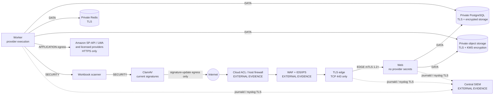

# Amazon SP-API network and infrastructure security

Last reviewed: 2026-08-30

This runbook defines RizPoint's supported hardened application topology and the
evidence required before answering Amazon infrastructure questions. It is not
proof that a firewall, WAF, IDS/IPS, endpoint agent, encrypted disk, SIEM, or
production TLS certificate has been deployed. Those controls remain
`EXTERNAL_OPERATION_REQUIRED` until a dated operator record references evidence
from the actual production environment.

## Authoritative basis

- [Amazon Key Security Control Guidance](https://developer-docs.amazon.com/sp-api/docs/guidance-to-address-key-security-controls-in-sp-api-integration), reviewed 2026-08-28.
- [Amazon SP-API policy update effective 2026-08-25](https://developer.amazonservices.com/policy-update-for-sp-api), reviewed 2026-08-28.
- [Safeguarding sensitive credentials](https://developer-docs.amazon.com/sp-api/docs/safeguarding-sensitive-credentials), reviewed 2026-08-28.

Amazon's current guidance calls for network segmentation, network firewalls and
ACLs, IDS/IPS, current server/endpoint anti-malware, SIEM/central log review,
TLS 1.2 or newer, encrypted storage, managed credentials, regular patching,
monthly anti-malware updates, and current operational evidence. The 2026 policy
update additionally requires a WAF for internet-facing endpoints. Application
rate limits, an Nginx reverse proxy, ClamAV upload scanning, or a JSON field do
not substitute for those external controls.

## Supported production boundary

`compose.production.yaml` is a **standalone** profile. Never merge it with
`compose.yaml`, which is the loopback-only local development/demo stack. The
production profile expects PostgreSQL, Redis, and object storage to be managed
private services with TLS and storage encryption. It does not start local data
containers.



The trust zones are:

- **EDGE**: only the TLS proxy and web service. Host TCP/443 maps to edge
  TCP/8443. Edge authenticates web over TLS 1.2+ mTLS on TCP/3443. The only
  plaintext hop is web-container loopback from stunnel to Next.js; it never
  crosses a network namespace.
- **APPLICATION**: worker provider egress. Web does not join this network and
  cannot receive LWA/provider-vault secrets.
- **DATA**: web, worker, and migrator reach only private managed TLS endpoints.
  Cloud routing, security groups, and ACLs must restrict those endpoints to the
  deployment identities/subnets.
- **SECURITY**: an internal Docker network containing only worker, scanner, and
  ClamAV. A separate ClamAV-only update network permits signature downloads.
- **MONITORING**: host journald is forwarded by rsyslog over authenticated TLS
  to the managed SIEM. Containers do not receive collector administration
  access or join its management plane.

Scanner and ClamAV process supplier upload content, not Amazon SP-API responses.
Those isolated same-host hops therefore do not carry Amazon Information. If
that scope changes or the services move to separate hosts, mTLS is mandatory.

### Allowed connectivity

| Source   | Destination                   | Port/protocol | Purpose                                |
| -------- | ----------------------------- | ------------- | -------------------------------------- |
| Internet | Edge                          | TCP/443       | HTTPS only                             |
| Edge     | Web                           | mTLS/3443     | authenticated reverse proxy            |
| Web      | PostgreSQL                    | TLS/5432      | tenant-scoped application state        |
| Web      | object storage                | HTTPS/443     | signed private uploads/downloads       |
| Worker   | PostgreSQL                    | TLS/5432      | canonical jobs/evidence                |
| Worker   | Redis                         | TLS/6379      | retryable queue transport              |
| Worker   | object storage                | HTTPS/443     | private evidence and exports           |
| Worker   | Scanner                       | TCP/8000      | isolated same-host workbook processing |
| Scanner  | ClamAV                        | TCP/3310      | isolated malware scanning              |
| Worker   | Amazon/LWA/licensed providers | HTTPS/443     | allowlisted server-side provider calls |
| ClamAV   | signature distribution        | HTTPS/DNS     | definitions update only                |
| Host     | managed SIEM                  | TLS/6514      | sanitized security events              |

Everything else is denied by topology and must be denied again at the cloud
security-group/network-firewall layer. Docker network names are not proof of a
cloud ACL.

### Complete Amazon Information transport inventory

| Information path                    | Amazon Information carried                           | Required protection / verifier evidence                       |
| ----------------------------------- | ---------------------------------------------------- | ------------------------------------------------------------- |
| Amazon SP-API → worker              | catalog, offers, fees, restrictions, seller metadata | HTTPS allowlisted Amazon endpoint; Node TLS minimum 1.2       |
| Login With Amazon → worker          | OAuth code/access token                              | official HTTPS LWA endpoint; access token remains memory-only |
| worker/web/migrator ↔ PostgreSQL    | normalized evidence and tenant workflow state        | TLS `sslmode=verify-full`, CA trust and hostname checking     |
| worker ↔ Redis                      | job identifiers and bounded job metadata             | `rediss://` with certificate validation                       |
| worker/web ↔ object storage         | authorized files, evidence, exports                  | HTTPS, certificate validation, private bucket and KMS at rest |
| edge ↔ web                          | requests and Amazon-derived projections              | private CA, mutual TLS 1.2+, service-name verification        |
| web ↔ browser                       | authorized evidence projections                      | trusted public TLS 1.2/1.3, HSTS and secure cookies           |
| services/host → security monitoring | sanitized security metadata and identifiers          | rsyslog TLS with CA/peer verification; no payloads or secrets |
| database/object backups             | retained Amazon evidence                             | encrypted transport to private encrypted backup destination   |

The scanner/ClamAV path is excluded only because its defined input is supplier
files. Raw Amazon payloads, refresh/access tokens, provider credentials and
supplier file contents are prohibited from monitoring and WAF logs.

## TLS and transport

- Nginx accepts TLS 1.2 and 1.3 only. Certificate and key files are mounted from
  operator-controlled secret paths and are never committed.
- Edge-to-web uses a private CA and mutually authenticated leaf certificates.
  Leaf validity is one year by default; the checker fails inside a 30-day
  renewal window. The CA private key is kept offline/in the secret manager.
- The supported host profile publishes TCP/443 only. If HTTP is enabled at a
  managed WAF/load balancer, it must perform a 308 redirect without forwarding
  credentials. RizPoint also redirects insecure page requests and rejects
  insecure API/callback requests without reflecting query values.
- HSTS is sent only after the HTTPS deployment is correctly configured.
- Production cookies are `Secure`, `HttpOnly`, and `SameSite=Lax`.
- Node processes run with `--tls-min-v1.2`.
- PostgreSQL requires `sslmode=verify-full`; Redis requires `rediss://`; object
  storage, public signed-object origin, monitoring, OAuth callbacks, and app
  origins require HTTPS.
- The SP-API adapter accepts only Amazon's current NA/EU/FE HTTPS endpoints.
- CSP excludes insecure production storage origins and upgrades insecure
  subresource requests.

Run a live TLS scanner against the deployed domain and retain its dated report.
Static Nginx configuration is not proof that DNS, certificates, forwarding,
HSTS, and the public endpoint are correct.

## Host firewall and public-port verification

Do not run firewall commands blindly on a workstation or a remote host without
recoverable console access. First align the cloud security group/NACL and the
host policy:

1. Default inbound `DENY`.
2. Allow TCP/443 to the TLS/WAF edge.
3. Allow SSH only from a reviewed administration VPN/source CIDR, or omit SSH
   when session-manager/console access is available.
4. Explicitly deny 80, 3000, 3001, 3310, 5432, 6379, 8000, 9000, 9001, and
   internal metrics from the internet.
5. Restrict outbound traffic to DNS, time, ClamAV updates, secret/KMS/monitoring
   services, private data services, Amazon/LWA, and licensed providers.

`deploy/amazon-production/firewall.sh` provides `plan`, `validate`, `apply`, and
explicit `rollback` modes. Apply requires root, confirmed provider-console
recovery and an exact reviewed confirmation. It preserves a root-only backup.
RizPoint never invokes it automatically. `cloud-acl.md` defines the reinforcing
provider firewall rules.

After deployment, verify from a separate external network:

```bash
pnpm security:amazon:ports -- --host=research.example.com --allow=443
```

Attach that sanitized output and cloud firewall screenshots/export to the
operator attestation. A loopback scan is not sufficient.

## WAF, IDS/IPS, and centralized monitoring

Choose and operate one appropriate production path:

- Managed cloud: internet WAF, managed network firewall/IDS, threat-detection
  service, centralized immutable logs, and SIEM/security findings; or
- Controlled Linux host: upstream managed WAF, Suricata on the reviewed host
  interface, host ClamAV daemon/on-access and scheduled protection, plus a
  managed TLS SIEM.

Required evidence includes the deployment/resource ID, protected subnet or
endpoint, enabled rule/policy set, alert destination, last healthy check, dated
test alert, retention, reviewer, and change ticket. Fail2ban and application
logs alone are not IDS/IPS or a WAF.
`deploy/amazon-production/host-controls.sh` installs and validates the supported
host agents, rule/signature freshness, audit/time/update services and
authenticated TLS log forwarding. The WAF/SIEM accounts and real host execution
remain `EXTERNAL_OPERATION_REQUIRED` until verified.

## Malware and endpoint protection

RizPoint preserves fail-closed upload scanning. Scanner readiness now requires
ClamAV to respond and its signature timestamp to be within
`CLAMAV_MAX_SIGNATURE_AGE_HOURS` (72 hours in the supported profile). The
readiness response exposes only engine/signature version and update time.
ClamAV cannot silently become stale while the scanner remains ready.

The supported production host additionally runs the ClamAV daemon, freshclam,
root-controlled on-access protection, a persistent daily scan timer, root-only
quarantine and signature-age validation. This still does **not** prove those
controls have been applied to the real host or that administrator workstations
are covered. Host output plus endpoint-estate evidence remains required.

## Encryption at rest

Application credentials use tenant-bound AES-256-GCM envelopes. The production
storage platform must additionally provide:

- encrypted PostgreSQL database/storage volumes and transaction logs;
- KMS-backed private object storage, encryption/versioning/lifecycle verified
  through the storage API;
- encrypted database dumps, snapshots, object versions, and geographically
  appropriate recovery copies;
- encrypted host/container volumes and endpoint disks;
- access-controlled security logs; and
- dedicated KMS/secret-manager keys with inventory, audit, revocation, and
  annual rotation.

The repository cannot inspect hypervisor disks or managed backup encryption.
Record provider-console/API evidence in the external attestation. An environment
variable that says encryption is enabled is not accepted as proof.

## Secret injection

Do not deploy `.env.production.example`; it is only a validation catalog. Do not
commit or copy a real `.env` into an image. Inject secrets from AWS Secrets
Manager/Parameter Store, HashiCorp Vault, Doppler, or the deployment platform's
equivalent into the container process at runtime. Restrict the worker identity
to LWA/provider keys, the web identity to the MFA/session key, and storage
identities to their required bucket actions.

For the supported operator-controlled deployment, run Compose inside 1Password
Secrets Automation (or an equivalent approved secret manager) and disable
automatic `.env` loading:

```bash
COMPOSE_DISABLE_ENV_FILE=1 op run --env-file=/private/rizpoint-production.env -- \
  docker compose --env-file /dev/null -f compose.production.yaml up -d
```

The private environment file contains secret-manager references, not values.
Equivalent Vault/cloud-manager process injection is allowed. TLS/key paths are
external files with restricted ownership. The browser artifact gate rejects database, Redis,
NextAuth, provider, LWA, refresh-token, S3, MFA, and callback-private-key marker
families.

## Deployment verifier and attestations

Static/code-ready check:

```bash
pnpm security:amazon:deployment-check
```

It must report no `FAIL`. Missing external evidence correctly reports
`MANUAL_VERIFICATION_REQUIRED`.

For the actual secret-injected runtime, copy
`deploy/amazon-hardened/operator-attestation.example.json` to the ignored
`operator-attestation.json`, fill it only after inspecting real controls, and
sign the exact bytes with an offline Ed25519 evidence key. Then run:

```bash
pnpm security:amazon:deployment-check -- \
  --live \
  --public-url=https://research.example.com \
  --attestation=/private/operator-attestation.json \
  --attestation-signature=/private/operator-attestation.sig \
  --attestation-public-key=/run/rizpoint/attestation/public.pem \
  --report-out=/private/rizpoint.deployment-report.json \
  --signing-key=/private/deployment-evidence-key.pem
```

The verifier checks topology, ports, fixed private/demo flags, TLS URL schemes,
PostgreSQL certificate verification, Redis TLS, provider endpoint allowlisting,
key length/placeholder rejection, the live certificate/TLS protocol/security
headers, legacy TLS rejection, internal mTLS, browser secret scanning, and the
age, signature and completeness of operator evidence. `--live` is always strict
and exits non-zero while any manual control remains. A report is never signed
unless every check passes. Import the JSON report and detached `.sig` in
**Settings → Security → Amazon Compliance**; it is stored per organization.

## Amazon questionnaire evidence matrix

### YES_NOW — repository/application facts

- The supported production profile publishes only a TLS edge on TCP/443; web,
  worker, scanner, ClamAV, metrics, database, Redis, and object administration
  have no host publications.
- Production application/provider endpoints fail closed unless transport is
  HTTPS/TLS; Node outbound TLS has a 1.2 minimum.
- PostgreSQL, Redis, and object-store connection configuration fails closed for
  plaintext transport in the supported profile.
- SP-API credentials remain encrypted and worker-only; browser bundles are
  scanned for all named secret families.
- CSP, HSTS, MIME sniffing, referrer, permissions, and clickjacking headers are
  configured.
- Uploaded files require ClamAV and current definitions; stale/unavailable
  scanning makes readiness fail.
- The repository supplies recovery-gated UFW, Suricata, host ClamAV,
  rsyslog-TLS, patching, PKI, certificate-age and host validation automation.
  These are `CODE_READY`, not proof they are deployed.

### YES_AFTER_DEPLOYMENT_VERIFICATION

- Cloud/host firewall and ACLs actually enforce the connectivity matrix.
- A WAF protects the public endpoint.
- IDS/IPS and SIEM are deployed, alerting, retained, and reviewed.
- Production TLS certificate, DNS, redirects, HSTS, and public protocol scan
  pass.
- Database, object, backup, log, server-volume, and endpoint-disk encryption are
  evidenced from the actual provider/host.
- Approved secret manager/KMS injection and key access policies are evidenced.
- Endpoint/server anti-malware is installed, current, tamper protected, and
  reviewed monthly.
- OS/container security updates and vulnerability remediation are operating on
  the required cadence.

### NO_NOT_YET

- No production firewall/WAF/IDS/IPS/SIEM/endpoint-protection installation has
  been verified in this repository.
- No live public TLS/port scan or managed-storage/backup encryption evidence is
  currently checked in—and real evidence must remain outside Git.
- DLP, dark-web/exfiltration monitoring, monthly infrastructure vulnerability
  scans, and annual external penetration/third-party assessments remain
  separate operational controls unless their current evidence is provided.

Do not convert a `YES_AFTER_DEPLOYMENT_VERIFICATION` item into `YES` on an
Amazon questionnaire until the dated evidence record and source platform prove
the control for the production deployment.
