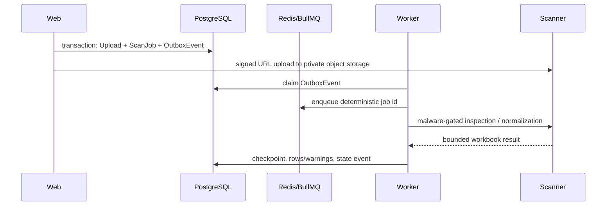

# Architecture

## Components

- **Web (`apps/web`)**: Next.js UI and user-facing API routes.
- **Worker (`apps/worker`)**: BullMQ queue dispatcher and processor owner.
- **Scanner (`services/scanner`)**: FastAPI/Polars service for deterministic file/data processing.
- **PostgreSQL**: canonical business state and checkpoint history.
- **Redis**: BullMQ transport only; it is not canonical job state.
- **MinIO**: local private S3-compatible object storage.

## Upload and mapping job flow

The transactional outbox prevents a request from creating a database job without a recoverable enqueue instruction. Claims carry a token and lease; stale claims are reclaimed. Published events whose scan/export target remains unfinished are also returned to `PENDING`, so Redis loss cannot strand canonical work. Delivery is at least once, so queue IDs include scan and stage (`UPLOAD_INSPECT`, `NORMALIZE`, `MATCH`, `ENRICH`, or `CALCULATE`), while checkpoints and terminal writes are idempotent. Enrichment stores every metric independently with provider, observed time, expiry/freshness, fee quoted price, and explicit missing-data flags. Throttled/transient provider results persist their retry time and schedule a delayed outbox retry before the run is finally `PARTIAL_SUCCESS`. Calculation reads persisted evidence, policy, and effective dated routes, then writes idempotent `ProfitCalculationRun` and `ProfitResult` records. Outages or missing inputs never silently complete data.

The initial and upload migrations are additive and include reviewed manual `rollback.sql` files for disposable/local recovery. Production rollback requires a backup and change-review decision because it deletes job history and uploaded-row state.

## State model

The upload slice uses `UPLOADED → MAPPING_REQUIRED → READY → NORMALIZING → COMPLETED → MATCHING → COMPLETED → ENRICHING → CALCULATING → COMPLETED|PARTIAL_SUCCESS`; a terminal inspection or normalization error sets the upload to `REJECTED` and the scan to `FAILED_FINAL`. Retryable failures retain their in-progress upload state and are retried safely. A duplicate request is represented by one outbox event per stage and an idempotent persistence stage. Exactly one upload sheet may be selected for normalization.

## Matching flow

The matching worker calls the typed catalog interface, validates provider payloads, persists provider lookup snapshots before reuse, scores candidate evidence deterministically, runs PackGuard, and writes a decision/checkpoint. Retryable matching jobs resume from persisted row decisions and lookup snapshots. The mock provider is the only Phase 2 adapter. Provider lookup keys are scan-scoped, preventing cross-tenant reuse of supplier-derived title queries.

## Provider boundary

Provider contracts are implemented in `packages/provider-contracts`. Any observed external metric requires provider, observation time, and freshness. Mock/recorded adapters are the default; the optional Amazon SP-API adapter is isolated in `packages/amazon-sp-api`, server-side only, and configuration-gated. The scanner HTTP boundary is validated at runtime by a TypeScript client owned by the worker.

The worker exposes `/health` for liveness and `/ready` only when PostgreSQL, Redis, and the scanner are reachable.

## Private production operation

Private production uses an authenticated owner session whose membership and session epoch are revalidated at the proxy boundary. Demo mode is local-only. Web is the sole public TLS service; worker, scanner, ClamAV, PostgreSQL, Redis, metrics, and S3 administration remain private. PostgreSQL and private object storage are backed up separately; Redis is treated as recoverable transport. Expired exports are identified by a checkpoint-safe retention run, initially in persisted report mode. See `OPERATIONS.md` and `RECOVERY_RUNBOOK.md`.

## Analysis workspace

The analysis API queries a tenant-scoped current-result projection in 100-row windows with allowlisted filters and sorting. Grid DTOs explicitly select lightweight fields; heavy evidence is fetched only for the drawer. An inline override transaction records typed Decimal values and audit metadata, creates a targeted calculation run, target, and run-ID outbox event together. Targeted processing fetches only target rows. Promotion verifies that the active override still points to the same run and revision, so an older worker cannot replace a newer result; targeted completion does not reset the scan ingestion state.

## Runtime baselines

## Phase 6 workflow and exports

Shortlist and purchase-order aggregates are organization-scoped PostgreSQL records. PO lines snapshot the selected current immutable profit scenario, route, supplier-owned ordering-rule provenance, quantities, pack conversion, MOQ, order-multiple rounding, and Decimal totals. Validation rebuilds line/header totals before transition. The worker owns export generation through the transactional outbox; export jobs are persisted before Redis publication, recover expired running leases, and write checksummed allowlisted CSV/XLSX artifacts to private object storage. Download routes verify the organization and redirect only on an explicit download request, never exposing object keys.

The local containers use Node 22 and Python 3.13+. Next.js requires Node 20.9 or newer; Prisma supports active/maintenance Node LTS releases. See the official [Next.js installation](https://nextjs.org/docs/app/getting-started/installation) and [Prisma system requirements](https://docs.prisma.io/docs/orm/reference/system-requirements).

Compose pins PostgreSQL, Redis, and MinIO release tags so local rebuilds do not silently float across versions.
