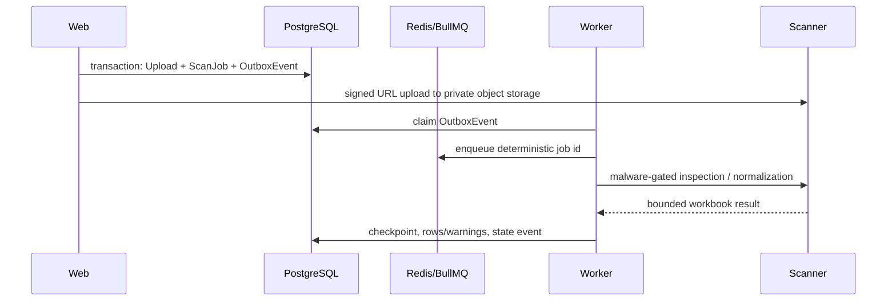

# Architecture

## Components

- **Web (`apps/web`)**: Next.js UI and user-facing API routes.
- **Worker (`apps/worker`)**: BullMQ queue dispatcher and processor owner.
- **Scanner (`services/scanner`)**: FastAPI/Polars service for deterministic file/data processing.
- **PostgreSQL**: canonical business state and checkpoint history.
- **Redis**: BullMQ transport only; it is not canonical job state.
- **MinIO**: local private S3-compatible object storage.

## Upload and mapping job flow

The transactional outbox prevents a request from creating a database job without a recoverable enqueue instruction. Claims carry a token and lease; stale claims are reclaimed. Published events whose scan/export target remains unfinished are also returned to `PENDING`, so Redis loss cannot strand canonical work. Delivery is at least once, so queue IDs include scan and stage (`UPLOAD_INSPECT`, `NORMALIZE`, `MATCH`, `ENRICH`, or `CALCULATE`), while checkpoints and terminal writes are idempotent. Enrichment stores every metric independently with provider, observed time, expiry/freshness, fee quoted price, and explicit missing-data flags. Throttled/transient provider results persist their retry time and schedule a delayed outbox retry before the run is finally `PARTIAL_SUCCESS`. Calculation reads persisted evidence, policy, and effective dated routes, then writes idempotent `ProfitCalculationRun` and `ProfitResult` records. Outages or missing inputs never silently complete data.

The initial and upload migrations are additive and include reviewed manual `rollback.sql` files for disposable/local recovery. Production rollback requires a backup and change-review decision because it deletes job history and uploaded-row state.

## State model

The upload slice uses `UPLOADED → MAPPING_REQUIRED → READY → NORMALIZING → MATCHING → ENRICHING → CALCULATING → COMPLETED|PARTIAL_SUCCESS`. Mapping confirmation stores a checksum checkpoint and is serialized per scan, so repeat submissions return the same persisted state. After each successful worker checkpoint, the workflow queues only the next missing stage; a restart or explicit resume consults those checkpoints rather than repeating completed work. Unsafe or malformed inspection/normalization input sets the upload to `REJECTED` and scan to `FAILED_FINAL`. Transient scanner failures retain the private object and in-progress upload state; BullMQ retries automatically, and an operator can requeue a completed retry budget using a new deterministic run-attempt job ID without uploading a duplicate. A duplicate request is represented by one outbox event per stage and idempotent persistence. Exactly one upload sheet may be selected for normalization.

## Matching flow

The matching worker calls the typed catalog interface, validates provider payloads, persists provider lookup snapshots before reuse, scores candidate evidence deterministically, runs PackGuard, and writes a decision/checkpoint. Retryable matching jobs resume from persisted row decisions and lookup snapshots. The mock provider is the only Phase 2 adapter. Provider lookup keys are scan-scoped, preventing cross-tenant reuse of supplier-derived title queries.

## Provider boundary

Provider contracts are implemented in `packages/provider-contracts`. Any observed external metric requires provider, observation time, and freshness. Mock/recorded adapters are the default; the optional Amazon SP-API adapter is isolated in `packages/amazon-sp-api`, server-side only, and configuration-gated. The scanner HTTP boundary is validated at runtime by a TypeScript client owned by the worker.

Catalog resolution selects the mock connection by default. In `sp_api` mode it
uses only an active encrypted SP-API connection for the organization. Catalog
Items raw responses are private persistence data; web DTOs use the normalized
typed projection and its provenance only.

The worker selects the fixture adapter unless `PROVIDER_MODE=sp_api` and an
active organization-scoped Amazon connection has a valid encrypted refresh
token. Decryption happens only in the worker using the connection's
organization-and-connection authenticated context. Missing, revoked, or
misconfigured connections fail as explicit provider data; they never fall back
silently to mock data. Provider-attempt idempotency is scoped to one enrichment
run so later scans cannot overwrite prior audit evidence.

The provider runtime control plane is shared by wholesale and research. A
`ProviderEntitlement` records one provider/marketplace/capability state and
explicit `MOCK` or `LIVE` origin. `ProviderRateBudget` uses NUMERIC windows and
idempotent reservations; row locking prevents concurrent over-reservation.
`ProviderCacheEntry` stores only a normalized private projection and evidence
reference with fresh, stale-while-revalidate, and retention deadlines.
`ProviderRequestLease` deduplicates concurrent calls, while
`ProviderRequestAttempt` stores sanitized hashes, state, timing, retry, cache
outcome, and optional NUMERIC credit/cost estimates—never request/response
payloads or credentials. Existing scan-bound `ProviderObservation` remains the
wholesale evidence record, and `ResearchObservation` remains the research
evidence envelope.

SP-API call attempts are dual-recorded into the legacy scan audit and the
normalized runtime telemetry. The worker bundle declares provider key, mode,
and capabilities. Live mode fails closed when an authorized live connection is
absent; it cannot fall back to mock. Capability status routes return only the
credential-free reason matrix.

Market history is an optional, separate checkpointed run attached to a scan.
It accepts at most 100 ASINs already accepted by that organization, claims the
same provider cache/lease key used by the runtime control plane, and writes
append-only `ResearchObservation`, `HistoricalMetricSeries`, and
`HistoricalMetricPoint` records. The Keepa adapter is server-only and receives
an API key only by decrypting the tenant's `ProviderCredential` in the worker.
Recorded history uses a distinct `MOCK` origin. Opaque response evidence is
redacted, stored in the private bucket, referenced from the cache and typed
observation, and removed with the shorter cache retention deadline; normalized
series retain their configured historical window.

History analytics runs immediately after a history item persists its normalized
points. `@rizpoint/history-analytics` is a pure Decimal-based package: it
accepts only typed series and returns versioned descriptive metrics, coverage,
and warnings. The worker persists immutable-input snapshots in
`HistoryAnalyticsAssessment`; it does not mutate raw observations or wholesale
profit results. Analysis detail reads both raw series and the latest
organization-scoped assessment, keeping the detailed history payload outside
the windowed results-grid query.

The Phase 7.6 connectivity boundary validates only official NA/EU/FE SP-API
endpoints. It exchanges an encrypted long-lived refresh token for a short-lived
LWA access token in worker memory, using a single-flight cache. The first
server-only connection probe is a non-destructive Sellers
`getMarketplaceParticipations` request; live catalog and pricing operations are
separate typed provider capabilities. Public status DTOs expose only a normalized
state and timestamp, never credentials or provider payloads.

Competitive pricing uses Product Pricing v2022-05-01
`getCompetitiveSummary` in batches of at most 20 unique marketplace/ASIN keys.
Requests explicitly ask for featured buying options and New/Consumer lowest
priced offers. Returned lowest offers are a bounded provider sample, so total,
FBA, and FBM counts are `PARTIAL` rather than whole-market totals. FBA describes
fulfillment only; Amazon Retail is `PRESENT` only through a verified,
marketplace-specific seller identity policy and otherwise remains `UNKNOWN`.
The worker checkpoints one typed observation per item/metric/provider, reuses
fresh observations on retry, refreshes stale observations, and rejects older
retry observations. Authorization, throttle, partial, retryable, terminal, and
unavailable states are persisted without false zero/absent values.

Account-specific fees use Product Fees v0
`getMyFeesEstimateForASIN`. The adapter preserves the requested scenario price,
listing/shipping split, fulfillment channel, Amazon result status, aggregate
total, and every returned fee detail. Component money is normalized into
`NUMERIC(18,4)` rows; aggregate-only responses are `PARTIAL` and cannot drive a
recommendation. The default usage plan is one request per second with burst two,
while response rate-limit headers remain authoritative when present. Amazon fee
estimates are point-in-time estimates and are never represented as guaranteed
future charges. Fee observations are scenario/request keyed. During calculation,
the worker reuses a fresh exact-price quote or obtains a missing current,
conservative, stress-price, or user-entered point quote through the typed fee
provider. In-process concurrent requests are single-flight; persisted request
hashes and observations make job retries idempotent.

Seller eligibility uses Listings Restrictions v2021-08-01
`getListingsRestrictions` for the authorized seller, marketplace, ASIN, and New
condition. Only a successful, complete response containing an explicitly empty
`restrictions` array becomes `ELIGIBLE`. Approval, ineligibility, incomplete,
unauthorized, throttled, and unknown states remain distinct. The documented
default usage plan is five requests per second with burst ten. Provider failures
are checkpointed as typed unknown evidence and never collapse to eligibility.

The worker exposes `/health` for liveness and `/ready` only when PostgreSQL, Redis, and the scanner are reachable.

## Private production operation

Private production uses an authenticated owner session whose membership and session epoch are revalidated at the proxy boundary. Demo mode is local-only. Web is the sole public TLS service; worker, scanner, ClamAV, PostgreSQL, Redis, metrics, and S3 administration remain private. PostgreSQL and private object storage are backed up separately; Redis is treated as recoverable transport. Expired exports are identified by a checkpoint-safe retention run, initially in persisted report mode. The download route fails closed once `expires_at` has passed (or is missing), even while report-mode retention has not yet deleted the private object. See `OPERATIONS.md` and `RECOVERY_RUNBOOK.md`.

## Analysis workspace

The analysis API queries a tenant-scoped current-result projection in 100-row windows with allowlisted filters and sorting. Grid DTOs explicitly select lightweight fields; heavy evidence is fetched only for the drawer. An inline override transaction records typed Decimal values and audit metadata, creates a targeted calculation run, target, and run-ID outbox event together. Targeted processing fetches only target rows. Promotion verifies that the active override still points to the same run and revision, so an older worker cannot replace a newer result; targeted completion does not reset the scan ingestion state.

An active-view export persists the versioned filter/sort/route state and the
current scan attempt revision before publishing one idempotent export outbox
event. The worker repeats the same tenant-scoped query in bounded 5,000-row
worker-only windows (the interactive API remains capped at 200), refuses a
superseded source revision, and writes the CSV/XLSX artifact only to private
storage. Evidence refresh is a named, idempotency-keyed request
that reuses the existing enrichment run/checkpoints. `Retry-After` is honored
exactly; retryable provider responses without a deadline use bounded jitter so
concurrent workers do not resume in lockstep.

## Runtime baselines

Local Compose executes the optimized Next.js production server. Its unauthenticated fixture mode is not the private-production mode: it requires both explicit demo flags, loopback application/auth URLs, and host ports bound to loopback. Private production continues to reject demo mode and requires authenticated membership.

## High-risk module boundaries

Cross-cutting orchestration remains behind the same package and route entry
points, while cohesive policy and presentation responsibilities live in focused
modules:

- `packages/database/src/repositories.ts` remains the stable database facade.
  Tenant-scoped analysis projections, filters, sorting, and evidence reads live
  in `packages/database/src/repositories/analysis.ts`; callers continue to
  import the same functions and types from `@rizpoint/database`.
- `apps/web/src/analysis/workspace.tsx` owns result-query state, paging,
  virtualization, edits, and actions. Typed view models, pure display
  formatting, and the accessible evidence dialog live in
  `workspace-types.ts`, `presentation.ts`, and `evidence-drawer.tsx`.
- `packages/amazon-sp-api/src/index.ts` remains the typed adapter entry point.
  AES-GCM credential storage, fee response normalization, and restriction-code
  policy live in `credential-vault.ts`, `fee-normalizer.ts`, and
  `restriction-policy.ts`. The package root continues to export the credential
  vault API used by the worker.
- `apps/worker/src/enrichment.ts` remains the checkpointed enrichment
  coordinator. Pure request-lineage construction, hashing, retry deadlines,
  provider error classification, and typed cache shapes live in
  `enrichment-policy.ts`; the existing `providerRetryDeadline` export remains
  available from the coordinator module.

These are source-only boundaries. They do not change routes, database schema,
tenant predicates, provider meanings, PackGuard gates, matching rules, or
Decimal financial behavior.

## Research bounded context

Research is additive to wholesale and shares the existing global
`CatalogProduct`/`ProductIdentifier` identity. A research project references that
identity directly; it never creates a second product truth table or a synthetic
supplier row. `PRIVATE_LABEL`, `WHOLESALE`, and `MANUAL_ASIN` are explicit project
modes, while all project, market, keyword, watch, note, assessment, and alert
records remain organization-scoped.

Research evidence uses a normalized two-level structure:

1. `ResearchObservation` is the immutable provenance envelope: organization,
   marketplace, provider key, operation, source key/reference, observation and
   expiry times, freshness, completeness, status, request lineage, and private
   raw-evidence reference.
2. A one-to-one typed projection (`KeywordObservation`,
   `ProductKeywordObservation`, `ProductMarketObservation`,
   `MarketObservation`, `CategoryObservation`, `BrandObservation`, or
   `SellerObservation`) stores queryable facts. Missing facts remain null.

The envelope is separate from scan-bound `ProviderObservation`, whose ownership
through `EnrichmentItem → SupplierRow` remains correct for wholesale. Provider
adapters will write the research envelope through later capability-specific job
handlers; Prompt 02 adds no live provider behavior.

Sparse history is stored as `HistoricalMetricSeries` plus append-only points.
Each point has exactly one typed value and references the observation that
retrieved it. A btree supports tenant/series/time reads and a BRIN index supports

### Research Project decision hub

`ProjectEvidenceReference` stores a private, authorized pointer rather than
duplicating attachment bytes. `ProjectAssumption` records a dated input and is
append-only in practice. `DecisionMemo` and `DecisionMemoSource` are immutable:
creation captures source IDs and compact evidence snapshots, while later data
refreshes create new assessments rather than changing a prior go/no-go memo.
Project comparisons are tenant-scoped, limited to ten project members, and use
only stored, labeled metrics; their deterministic explanations are not an
opaque composite score.

### Research Copilot boundary

The Research Copilot is a read-only, tenant-scoped allowlist of retrieval
operations. It cannot produce SQL, call mutations, expose raw provider
payloads, or calculate financial outputs. Every returned fact carries the
internal assessment/memo/assumption ID that supplied it; derived text and
hypotheses are explicitly separated. Imported text is treated as untrusted and
instruction-shaped content is redacted before operation selection.

### Alerts and change detection

Alert rules evaluate only a matching stored historical observation. Missing,
stale, or unsupported provider values skip evaluation rather than becoming zero.
Events preserve observed time, trigger inputs, source observation IDs, and a
stable rule/observation/value dedupe key. The worker's five-minute evaluator
also honors per-rule cooldowns; notification delivery is in-app only until an
authorized delivery provider is configured.
time-based retention scans. Series default to 730 days; provider rights may
require a shorter period. Retention deletes expired points in bounded batches,
never invents interpolation, and keeps PostgreSQL partition-ready. A separate
time-series database or partitioning is deferred until scale measurements prove
the need.

`OpportunityAssessment` and its ordered reasons are immutable derived records.
They store a calculation version, `calculated_at`, and explicit input observation
references. They cannot update or replace the raw observation envelope. The
database repository boundary is `packages/database/src/repositories/research.ts`;
commands validate typed subjects and all reads/writes carry `organization_id`.

## Product Explorer

Product Explorer has a distinct server query boundary in
`packages/database/src/repositories/product-explorer.ts`. Its SQL derives a
tenant-authorized product universe from organization-owned relationships before
joining the global catalog identity table. It then selects only typed current
pricing and normalized historical facts, with an exact filtered count and a
maximum 100-row server window. Opaque provider payloads and global catalog rows
without an organization relationship are never browser results. Explorer views
reuse the versioned `AnalysisView` persistence pattern with a null scan scope
and Explorer schema version; they do not change scan analysis views.

## Category Intelligence

Category Intelligence is a server-side read projection in
`packages/database/src/repositories/category-intelligence.ts`. It first applies
the same tenant-owned union as Product Explorer, then derives category nodes
from the catalog identity projection's observed product type. Category lists,
detail product rows, and aggregate inputs are bounded server windows; details
return the exact matching tracked count, aggregation-window count, source
universe, and generation date. Aggregate math uses `decimal.js` and excludes
null observations rather than assigning zero. A `MarketDefinition` with a
`CATEGORY_TRACKED_UNIVERSE` definition is the idempotent category-watch
boundary. It represents saved intent only and cannot imply provider search or
Amazon-wide category membership.

## Opportunity Finder

Opportunity Finder stores a niche definition in a versioned `MarketDefinition`
and writes idempotent immutable `NicheAssessment` snapshots. The pure Decimal
scorer records thresholds, component outputs, a calculation version, and an
input fingerprint/reference list. It uses no AI or BSR-to-sales heuristic.

## Sales estimation

`SalesEstimateProvider` is the licensed direct-estimate boundary. The separate
`@rizpoint/sales-estimation` engine can use rank history only with a validated
`SalesEstimationModel` matching both marketplace and category. Registry rows
retain the reference dataset identifier/source, sample size, versioned
parameters, and backtest metrics. Immutable `SalesEstimate` rows label provider
versus modeled origin and retain interval, confidence, model version,
fingerprint, evidence references, and observation time. No model is seeded by
default, so uncalibrated BSR history produces no estimate.

## Phase 6 workflow and exports

Shortlist and purchase-order aggregates are organization-scoped PostgreSQL records. PO lines snapshot the selected current immutable profit scenario, route, supplier-owned ordering-rule provenance, quantities, pack conversion, MOQ, order-multiple rounding, and Decimal totals. Validation rebuilds line/header totals before transition. The worker owns export generation through the transactional outbox; export jobs are persisted before Redis publication, recover expired running leases, and write checksummed allowlisted CSV/XLSX artifacts to private object storage. Download routes verify the organization and redirect only on an explicit download request, never exposing object keys.

The local containers use Node 22 and Python 3.13+. Next.js requires Node 20.9 or newer; Prisma supports active/maintenance Node LTS releases. See the official [Next.js installation](https://nextjs.org/docs/app/getting-started/installation) and [Prisma system requirements](https://docs.prisma.io/docs/orm/reference/system-requirements).

Compose pins PostgreSQL, Redis, and MinIO release tags so local rebuilds do not silently float across versions.

## Private-label financial boundary

Private-label quote comparison is isolated in `private-label-profit/v1`, an
additive module of `@rizpoint/profit-engine`. It accepts Decimal strings and a
complete typed cost register; it does not reuse supplier-row PackGuard inputs or
alter `profit-engine/v3` wholesale results. Project-scoped quote, cost, FX, base,
and stress records are NUMERIC-backed and preserve formula version, source,
assumption/observation dates, confidence, input snapshot, and reason codes.
Unknown costs block calculation and estimated costs remain visible.

## Compliance-risk screening boundary

Compliance screening is a deterministic research projection in
`packages/database/src/compliance-risk-policy.ts`, not an AI or provider
conclusion. `ComplianceRuleSet` and `ComplianceRule` are organization-scoped,
source/date/version-bearing configuration. Creating a version archives the
prior active ruleset for the same marketplace and jurisdiction; it does not
edit a rule that an earlier assessment used. `ComplianceRiskAssessment` retains
the exact ruleset, product/fact/manual input references, input fingerprint, and
per-domain output for replay. The repository rejects a `LOW` rule without an
authoritative clearance flag and source. Unmatched domains are explicitly
`UNKNOWN` and launch-blocking. Existing SP-API listing restrictions can add an
authorized seller-eligibility observation to the Amazon-restriction domain, but
`ELIGIBLE` remains `UNKNOWN` for compliance because eligibility is not a legal
or certification clearance.

## Portfolio optimization boundary

`@rizpoint/portfolio-optimizer` is a pure Decimal integer branch-and-bound
engine with stable sorting and tie breaks. It accepts explicit candidate
economics/evidence, hard risk and concentration policy, cash budget, and stored
stress magnitudes. Each scenario is solved independently and returns only an
exactly proven result. Candidate/option/node bounds protect runtime; exceeding a
bound produces `SOLVER_FAILED` with no partial recommendation.

The database repository verifies every candidate is a CatalogProduct in the
organization's selected ResearchProject and that ASIN identity is consistent.
`PortfolioOptimizationRun` idempotently keys the canonical input hash;
`PortfolioOptimizationResult` stores scenario/rank, NUMERIC totals, assumptions,
constraint audit, exclusions, concentration, and exactness; and
`PortfolioAllocation` stores NUMERIC cash/profit rows plus MOQ/case and evidence
references. These derived records never mutate source profit, compliance,
demand, or provider observations. See [Portfolio optimizer](PORTFOLIO_OPTIMIZER.md).
