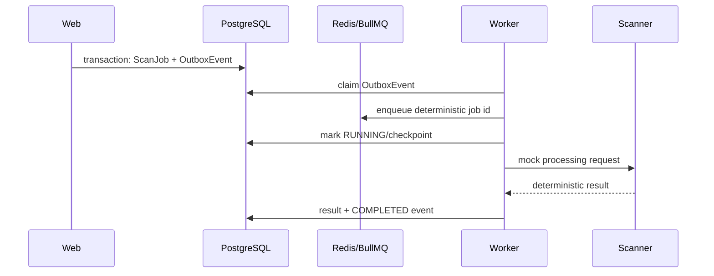

# Architecture

## Components

- **Web (`apps/web`)**: Next.js UI and user-facing API routes.
- **Worker (`apps/worker`)**: BullMQ queue dispatcher and processor owner.
- **Scanner (`services/scanner`)**: FastAPI/Polars service for deterministic file/data processing.
- **PostgreSQL**: canonical business state and checkpoint history.
- **Redis**: BullMQ transport only; it is not canonical job state.
- **MinIO**: local private S3-compatible object storage.

## Phase 0 job flow

The transactional outbox prevents a request from creating a database job without a recoverable enqueue instruction. Claims carry a token and lease; stale claims are reclaimed. Delivery is at least once, so queue IDs, checkpoints, and terminal writes are idempotent.

The initial migration is additive and includes a reviewed manual `rollback.sql` for disposable/local recovery. Production rollback requires a backup and change-review decision because it deletes job history.

## State model

Phase 0 uses `QUEUED`, `RUNNING`, `COMPLETED`, `FAILED_RETRYABLE`, and `FAILED_FINAL`. The complete product will add `UPLOADED`, `MAPPING_REQUIRED`, `READY`, `NORMALIZING`, `MATCHING`, `ENRICHING`, `CALCULATING`, `CANCELLED`, and `PARTIAL_SUCCESS`.

## Provider boundary

Provider contracts are implemented in `packages/provider-contracts`. Any observed external metric requires provider, observation time, and freshness. Adapters are mocks in Phase 0. The scanner HTTP boundary is validated at runtime by a TypeScript client owned by the worker.

The worker exposes `/health` for liveness and `/ready` only when PostgreSQL, Redis, and the scanner are reachable.

## Runtime baselines

The local containers use Node 22 and Python 3.13. Next.js requires Node 20.9 or newer; Prisma supports active/maintenance Node LTS releases. See the official [Next.js installation](https://nextjs.org/docs/app/getting-started/installation) and [Prisma system requirements](https://docs.prisma.io/docs/orm/reference/system-requirements).

Compose pins PostgreSQL, Redis, and MinIO release tags so local rebuilds do not silently float across versions.
